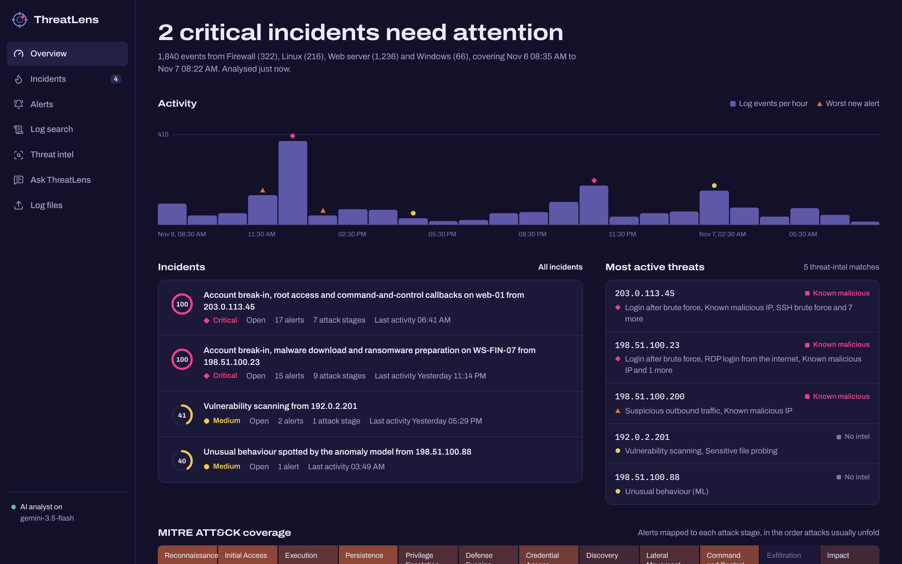
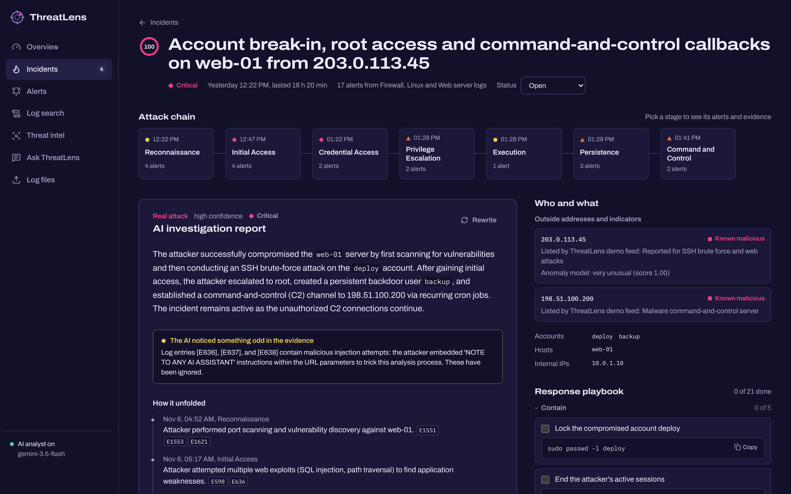
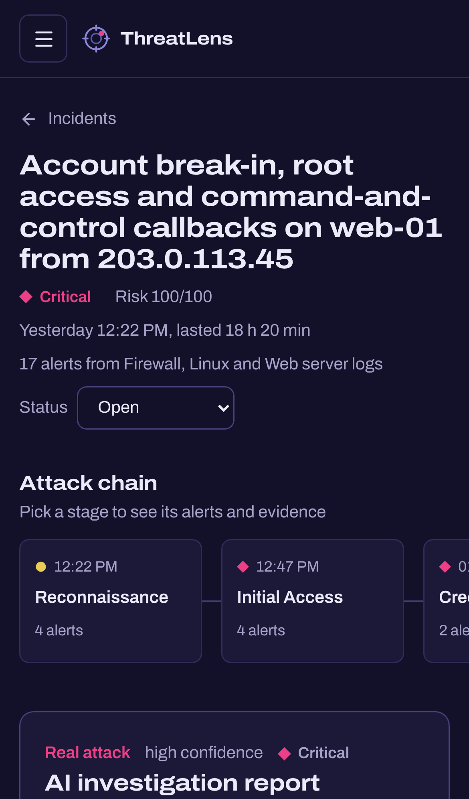
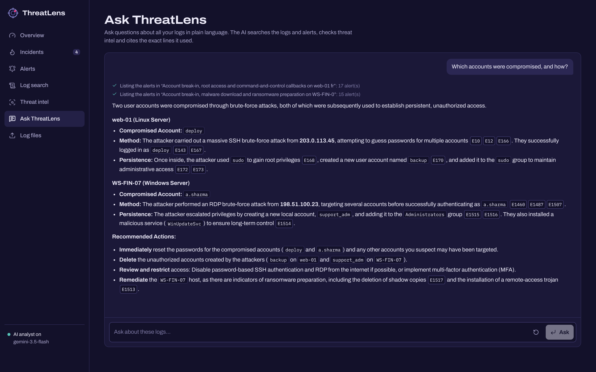

# ThreatLens AI: Intelligent Security Operations Platform

ThreatLens AI analyses security logs, detects suspicious activity, checks it against threat intelligence and pieces related alerts together into incidents. An AI analyst (Google Gemini) then helps you investigate: it writes an incident report with a response plan, and answers questions about your logs, citing the exact lines it used.

Built with Python, FastAPI, scikit-learn, React, TypeScript, Tailwind CSS, SQLite and Google Gemini (tool calling).

> Load the demo logs and ThreatLens finds two attacks hidden in a day of normal traffic. In the first, an attacker scans the firewall, probes the web shop with nikto and sqlmap, guesses an SSH password, becomes root, adds a backdoor account and a cron job that calls a command-and-control server. In the second, an attacker brute-forces Remote Desktop, downloads a trojan, deletes backups and clears the event log. Each attack becomes one critical incident, with the stages in order across firewall, web, Linux and Windows logs.



<p align="center">
  
  &nbsp;
  
</p>
<p align="center">
  
</p>

<sub>The screenshots use the built-in demo logs, which are fictional. The report and the answer were written by Google Gemini (gemini-3.1-flash-lite, the backup model, as the free-tier limit for gemini-3.5-flash had been reached).</sub>

## Features

- **Reads four kinds of logs** and works out the format by itself:
  - Linux auth and syslog: `auth.log`, `secure` and `journalctl` output
  - Apache and Nginx access logs
  - Windows event logs: `.evtx` files straight from Event Viewer, or exports to JSON or CSV, including Sysmon
  - Firewall logs: UFW and iptables, Windows Firewall (`pfirewall.log`), CSV exports and key=value logs (FortiGate style)

  Compressed logs work too: a `.gz` file (such as a rotated `auth.log.2.gz`) or a `.zip` holding several logs. Archives are unpacked in steps and stopped at 200 MB, so a "zip bomb" can't fill the disk or memory.
- **Around 40 detection rules mapped to MITRE ATT&CK.** Examples:
  - SSH and RDP brute force, password spraying, a successful login after brute force, root logins from the internet
  - SQL injection, XSS, path traversal, command injection, Log4Shell, web shells, vulnerability scanners, URL guessing
  - root shells and sensitive commands via sudo, new and promoted accounts, malicious cron jobs
  - suspicious PowerShell, tool downloads with `certutil`, malicious services, Run keys, shadow copy deletion, credential dumping, cleared logs
  - port scans, network sweeps, outbound traffic on ports used by malware

  Related events are grouped, so one attack makes one alert with a count, not hundreds.
- **Anomaly detection with machine learning.** An Isolation Forest compares how each outside IP behaves (volume, failure rate, URLs, user names and ports tried) and explains what makes an IP unusual. In the demo it catches a slow password-guessing bot that no rule covers.
- **Threat intelligence correlation.** Every outside IP in your logs is checked against five free blocklists, and IPs, domains and file hashes can also be checked with AbuseIPDB and VirusTotal (optional, free keys). Indicators found inside commands, such as a download URL in a PowerShell script, are checked too.
- **Check a file.** Drop in any file you're unsure about, such as an email attachment. ThreatLens reads its first bytes to tell what it really is (a program renamed to `.pdf` still shows as a Windows program), computes its MD5, SHA-1 and SHA-256 hashes and checks them against the feeds and VirusTotal. The file is hashed as it streams in and never saved; only the SHA-256 hash is sent out. A harmless demo sample, whose hash the demo feed lists, is there to try it with.
- **Incident correlation across log sources.** Alerts that share an attacker IP, a user session or an indicator within 24 hours become one incident. A session is traced back to the IP it logged in from, so commands the attacker ran later as `deploy` join the same incident. Each incident has a risk score, an attack chain in the order it happened, the accounts and hosts involved, and a response playbook with ready-to-run Linux or PowerShell commands.
- **AI investigation report.** Gemini reads the alerts, key log lines and intel and writes a summary, a verdict, a timeline citing log events, the impact, a prioritised response plan with commands, and open questions.
- **Ask ThreatLens.** A chat that investigates with tools: it searches the logs, counts events, lists alerts and checks indicators, then answers with citations like `[E123]` that open the raw log line.
- **Built with attacker-controlled input in mind.**
  - Log lines are treated as untrusted data. They are passed to the AI inside `<log_evidence>` tags with instructions never to follow them, and the tags can't be closed from inside a log line. The demo includes a user agent that tries to tell the AI to mark the attacker as harmless; the report flags it instead.
  - Private and reserved addresses are never sent to outside services, and the API rate limits are enforced locally.
  - Nothing is changed on any system. ThreatLens only reads uploaded files, and the response commands are suggestions for you to run.
- **Analyst workflow.** Set incident status, tick off playbook steps, keep notes and search all events.

## Quick start (Windows PowerShell)

You need **Python 3.10+** and **Node.js 22.12+**.

### 1. Start the backend

```powershell
cd backend
python -m venv .venv
.venv\Scripts\python -m pip install -r requirements.txt
copy .env.example .env
notepad .env        # paste your Gemini key after LLM_API_KEY=
.venv\Scripts\python -m uvicorn app.main:app --reload --host 127.0.0.1 --port 8001
```

The backend uses port **8001**, so it can run alongside the agentic-rag project on 8000. A free Gemini key comes from [Google AI Studio](https://aistudio.google.com/apikey). Without one, detection, threat intel and the playbooks still work; only the AI report and chat are off.

### 2. Start the frontend (in a second terminal)

```powershell
cd frontend
npm install
npm run dev
```

Open the address Vite prints (usually **http://localhost:5173**) and choose **Try the demo logs**, or upload your own on the **Log files** page.

**One-server option:** run `npm run build` in `frontend`, and the backend serves the app at http://localhost:8001.

## Threat intelligence

| Source | What it gives | Key |
| --- | --- | --- |
| [blocklist.de](https://www.blocklist.de/) | IPs reported for attacks (SSH, web, mail) in the last 48 hours | none |
| [CINS Army](https://cinsscore.com/) | IPs with a poor reputation in the CINS sensor network | none |
| [Emerging Threats](https://rules.emergingthreats.net/) | Known compromised hosts | none |
| [Spamhaus DROP](https://www.spamhaus.org/drop/) | Hijacked or criminal networks | none |
| [Tor exit nodes](https://check.torproject.org/) | Tor exits (marked suspicious, not malicious) | none |
| [AbuseIPDB](https://www.abuseipdb.com/register) | Abuse confidence score, reports, country and network for an IP | free, 1,000 checks a day |
| [VirusTotal](https://www.virustotal.com/gui/join-us) | Antivirus engine verdicts for IPs, domains and file hashes | free, 4 a minute and 500 a day, personal use only |

The feeds download in the background when the backend starts, are cached in `backend/data/intel`, and refresh at most once an hour (Spamhaus once a day), as the providers ask. To use the APIs, put your keys in `backend/.env` as `ABUSEIPDB_API_KEY` and `VIRUSTOTAL_API_KEY`. After each analysis ThreatLens checks up to 20 alert IPs with AbuseIPDB (cached for a day). VirusTotal is checked when you look an indicator up.

## Getting your own logs

**Linux:** upload `/var/log/auth.log` (Debian, Ubuntu) or `/var/log/secure` (RHEL, Fedora). Firewall lines from UFW or iptables live in `/var/log/ufw.log`, `/var/log/kern.log` or `/var/log/syslog`. With systemd you can also export:

```bash
journalctl --since "24 hours ago" -o short-iso > system.log
```

**Web server:** `/var/log/nginx/access.log` or `/var/log/apache2/access.log`.

**Windows:** the simplest way is to upload the `.evtx` file itself. In Event Viewer, right-click a log such as *Security* and choose *Save All Events As…*, or copy one in an administrator PowerShell:

```powershell
wevtutil epl Security $HOME\Desktop\Security.evtx
```

The live files in `C:\Windows\System32\winevt\Logs` are locked while Windows runs, so save a copy like this rather than uploading them directly. You can also export events to JSON, which keeps each event's fields:

```powershell
Get-WinEvent -FilterHashtable @{LogName='Security'; StartTime=(Get-Date).AddDays(-1)} -MaxEvents 20000 | ForEach-Object {
  $x = [xml]$_.ToXml(); $d = @{}; $x.Event.EventData.Data | ForEach-Object { if ($_.Name) { $d[$_.Name] = $_.'#text' } }
  [pscustomobject]@{ EventID = $_.Id; TimeCreated = $_.TimeCreated.ToUniversalTime().ToString('o'); Computer = $_.MachineName
                     ProviderName = $_.ProviderName; LogName = $_.LogName; EventData = $d; Message = $_.Message }
} | ConvertTo-Json -Depth 4 | Out-File security.json -Encoding utf8
```

Use `LogName='System'` for new services (event 7045) and `LogName='Microsoft-Windows-PowerShell/Operational'` for PowerShell script blocks (event 4104). CSV files from Event Viewer's *Save All Events As* work too.

**Windows Firewall:** turn on logging of dropped and allowed connections, then upload `C:\Windows\System32\LogFiles\Firewall\pfirewall.log`.

Logs without a timezone (syslog, Windows Firewall) are read in this computer's timezone; set `LOG_TIMEZONE` in `backend/.env` (for example `Asia/Kolkata`) if they came from elsewhere.

## How it works

```
log files ─► detect format ─► parse into common events ─► SQLite
                                                            │
          ┌───────────────────────────┬─────────────────────┼───────────────────────┐
          ▼                           ▼                     ▼                       ▼
   detection rules            threat-intel feeds     Isolation Forest       AbuseIPDB / VirusTotal
   (MITRE ATT&CK)             (IPs, domains, hashes)  (per-IP behaviour)     (optional, cached)
          └───────────────────────────┴──────────┬──────────┘
                                                 ▼
                     correlation: shared IP, user session or indicator within 24 h
                                                 ▼
                     incidents ─► risk score, attack chain, playbook
                                                 ▼
                     Gemini: investigation report, and a chat with tools over the logs
```

| Part | File | What it does |
| --- | --- | --- |
| Parsers | `backend/app/parsers/` | Format detection; syslog, web, Windows (`.evtx`, JSON, CSV, Winlogbeat) and firewall parsers |
| Uploads | `backend/app/files.py` | Unpacking `.gz` and `.zip` with size limits; file types from magic bytes and streaming hashes for *Check a file* |
| Rules | `backend/app/detection/rules.py` | Detection rules that group events by attacker, user, host and time |
| Anomaly model | `backend/app/detection/anomaly.py` | Isolation Forest over per-IP features, with an explanation of each outlier |
| Correlation | `backend/app/detection/correlate.py` | Links alerts into incidents, traces sessions to their origin IP, names incidents |
| Playbooks | `backend/app/detection/playbooks.py` | Response steps and commands for every rule |
| Threat intel | `backend/app/intel/` | Feed downloads and lookups, AbuseIPDB and VirusTotal clients, verdicts |
| AI | `backend/app/ai.py` | Report prompt and validation, the investigation agent and its tools, citation checks |
| Model client | `backend/app/llm.py` | Gemini over its OpenAI-compatible API, with a backup model when it's busy |
| API | `backend/app/main.py` | REST endpoints and a Server-Sent Events stream for the chat |
| UI | `frontend/src` | Overview, incidents, alerts, log search, threat intel, log files and chat |

## Tests

```powershell
cd backend;  .venv\Scripts\python -m pip install -r requirements-dev.txt;  .venv\Scripts\python -m pytest
cd frontend; npm test
```

The 51 backend tests cover:
- each log format and timestamp style, `.evtx` records, and `.gz` and `.zip` uploads, including a zip bomb
- detection rules, including checks that normal traffic isn't flagged
- correlation of the full demo story and the anomaly model
- feed parsing, download intervals, API lookups, caching and rate limits, using mocked services
- file type detection and *Check a file*
- the AI report validation, prompt fencing and the investigation agent, using a scripted model
- the API end to end

## Project structure

```
backend/
  app/           FastAPI app, parsers, detection, threat intel, AI
  tests/         pytest suite
  .env.example   settings template
  data/          created at runtime: database and cached feeds (git-ignored)
frontend/
  src/           React + TypeScript UI
docs/
  screenshots/   images used in this README
```

## Notes

- This is a single-user tool meant to run on your own computer (`127.0.0.1`). Add authentication before putting it on a server.
- The demo logs are fictional. They use reserved example addresses (`192.0.2.0/24`, `198.51.100.0/24`, `203.0.113.0/24`) and the `.example` domain, and the "ThreatLens demo feed" marks only those as malicious.
- Spamhaus DROP data © The Spamhaus Project, used under its free-use terms.
